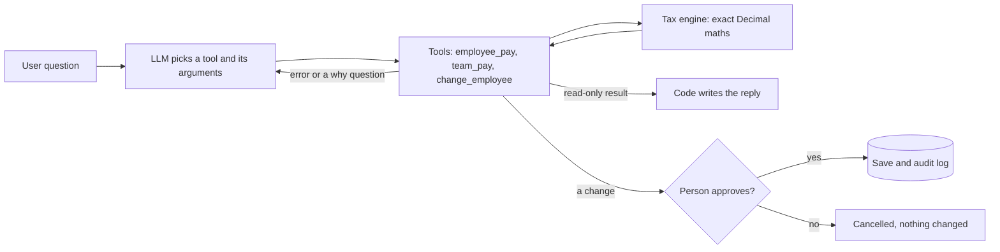

# payroll-agent

An AI assistant for South African small-business payroll. You ask in plain language and it answers with exact figures from the SARS 2026/27 tax tables. It can also change employee records, but only after a person approves each change, and every approved change is written to an audit log.

It is a spin-off of my [PayrollZA](https://github.com/henke4rie-oss/PayrollZA) project (`payroll_agent/engine.py` is a copy of that tax engine).

```
You: whats thandis uif
Agent: Thandi Nkosi's UIF is R177.12 a month.

You: who pays the most paye
Agent: Sipho Dlamini pays the most PAYE: R8,304.75 a month.

You: what if she was 66?
Agent: At age 66, Thandi Nkosi's PAYE would be R2,567.25 a month (nothing was changed).

You: set sipho dlamini's salary to 45000

Please confirm: Change Sipho Dlamini's gross_monthly: R42,000.00 -> R45,000.00. Net pay would go from R33,518.13 to R35,547.30.
Approve? [y/N] n
Agent: Cancelled. Nothing was changed.
```

## Results

All numbers below are measured on this project (logs and `evals/`), not estimates.

| | Result |
|---|---|
| Live eval (31 real phrasings) | **27 to 28 of 31** depending on the run (see "Known limitations"). Two cases fail every run and two sometimes |
| Unit tests | **119**, no API key needed |
| Input tokens per simple question | about **3,100** over 2 model calls at first, about **770** over 1 call now (average of the one-call eval cases) |
| Reply time | typically **0.4 to 0.7 s** per model call on Groq. On the free NVIDIA endpoint I used first, one question took 174 s (two 60 s timeouts plus a slow third attempt). Most of that gain is the provider, not my code. |
| `agent.py` | about 600 lines (mostly phrase-matching rules) replaced by about 300 lines |

## Why an agent and not a workflow?

A fixed workflow or form is the right tool for a routine payroll run. An agent earns its place at the front end, where requests are loose and vary: "make Sipho's salary 25k", "what would Thandi take home at 66?", "who's our biggest cost?", "fix the spelling of Zanele's surname". Each needs a different sequence of tools, and names can be vague or mistyped. The model chooses the next step, but my code controls what it is allowed to do. The money calculations stay in plain deterministic code.

## How it works



1. The user types a request.
2. The model turns it into a tool call with structured arguments: which person, which figures (`fields`), which period, or which team-wide answer (`team_pay`).
3. My code runs the tool, which uses the deterministic engine for every number.
4. For clear read-only results, my code writes the reply from the tool's arguments and numbers, with no second model call. For changes, errors and "why" questions, the result goes back to the model.
5. This repeats until there is an answer (maximum 6 steps).

The model decides *what was asked* (it is good with language: "thandis uif", "tax numbers", "who takes home the least"). Code decides *what is true* (the numbers, the wording of figures, the approval check). The first version guessed intent with hand-written phrase rules, and every new phrasing broke it. I replaced those with structured tool arguments, so a new phrasing doesn't need a new rule.

Salaries can be quoted per month, year, week or day, and the answer can be shown in a different period. A daily rate without a work schedule makes the tool return an error, so the model asks for the number of paid workdays per week.

### Tools

| Tool | What it does | Changes data? |
|---|---|---|
| `employee_pay` | One employee (or a given salary and age): chosen figures, what-ifs, any period, or the tax breakdown. Suggests close names on a typo | No |
| `team_pay` | Everyone: list, count, who has the highest or lowest of a figure, company totals | No |
| `change_employee` | `approve` a payslip, `update` salary or age, `add`, `rename` (full current name) or `remove` (full name; a copy goes in the audit log) | Yes, needs approval |

Under these three sit the small functions in `tools.py` (lookup, payslip, update, add, rename, remove). They are what the tests exercise directly and what keeps each rule in one place.

### Evaluation

`python -m evals.run` runs 31 real phrasings (typos, possessives, follow-ups, rankings, what-ifs, declined changes) against the live model. Each reply is graded for the figures it must contain, the figures it must not contain, and invented amounts. Results are saved to `evals/results/`, and the baseline from before the redesign is in `evals/baseline.json`. It uses real tokens (about 30k per run) and paces itself under the free-tier limit (`EVAL_TPM`), so it is run on demand, not as part of `pytest`.

## Design decisions

- **The model never does maths.** All money calculations use exact `Decimal` arithmetic in the engine.
- **Numbers come from the engine, not the model.** The figures in a reply are calculated and attached by code.
- **Human-in-the-loop on every change.** The approval check is in the tool code, so the model cannot skip it. The person sees a before and after (including the net pay effect) and nothing is saved unless they type `y`.
- **Tools take names, figures and values only.** Payslips and totals are recalculated in code, so the model can't get an invented number approved.
- **Risky actions need the exact full name.** Rename and remove refuse partial names, so "Sipho" can never delete the wrong Sipho.
- **Typos are caught, not guessed.** A not-found error suggests close names (difflib) and the prompt tells the model to ask the user which one they meant.
- **Input validation.** Names are tidied (extra spaces) and limited to letters, spaces, apostrophes, hyphens and full stops. Duplicate names are refused, ignoring case. Ages must be whole numbers and the engine rejects impossible ages. Salaries must be above zero.
- **"What if" is not a change.** Questions like "what would her pay be at 66?" use the read-only tool and never touch the data.
- **Audit log.** Every approved change is recorded with a timestamp.
- **Step limit and retries.** A confused model can't loop forever, and temporary API errors (rate limits, overload, timeouts) are retried with a growing wait.
- **Layers are separate files.** `engine.py` (tax maths), `store.py` (data), `tools.py` (what the agent can do), `agent.py` (the loop), `llm.py` (the only file that knows about the model provider). Tests use a scripted fake model, so they need no API key.

## Setup

1. `python -m venv .venv` and activate it (Windows: `.venv\Scripts\activate`)
2. `pip install -r requirements.txt`
3. Get a free API key from console.groq.com
4. Copy `.env.example` to `.env` and set `LLM_API_KEY` (optionally set `LLM_MODEL`; defaults to `openai/gpt-oss-20b`)
5. `python main.py` for clean output, or `python main.py --stats` to see each model call, tool call, timing and token count.

No Docker needed: this project has no database or server.

Things to try:
- `What is Thandi Nkosi's net pay?`
- `What would Thandi's pay be at 66?` (what-if, changes nothing)
- `Change Thandi's age to 66` (asks you to approve)
- `Why is Johan van der Merwe's tax lower than you'd expect?`
- `Sipho's salary is now 30k` (two Siphos, so it should ask which one)
- `Change Thandy's age to 66` (typo, so it should suggest Thandi)
- `Fix the spelling of Thandi Nkosi to Thandi Nkosie`
- `Add Zanele Mkhize, 35, R30000`
- `What's the total payroll?`

## Meet Penny (web chat)

Penny is the web version of the agent: a chat page where you ask questions in plain language, and every change waits for an **Approve** or **Reject** click.

```bash
.venv/bin/uvicorn web.server:app --port 8000   # then open http://localhost:8000
```


The app has a sidebar with three pages, and the chat follows you: on Team and Activity it sits in a panel on the right, and it is the same conversation, so you can ask on one page and carry on on another. **Chat** is where you ask and approve. **Team** shows everyone's monthly figures from the tax engine, with a totals row, and highlights whoever you just changed. **Activity** lists every change a person approved. Team and Activity are read-only and never call the model, so changes can only happen through the chat and its approval card.

The chat page has two groups of suggestions:
- **Ask Penny:** everyday questions, like *Tax numbers for everyone* (everyone's figures come from the tax engine and are shown as a table).
- **See the safeguards:** prompts chosen to show how Penny stays safe. Each says what to watch for when you click it: *Approval* (nothing saves until you click Approve), *Typo catch* (she asks which person you meant), *Two-part question* (both parts get answered) and *Unknown person* (she never invents a number).

Each browser session works on its own copy of the demo data, so nothing in the repo changes.

## How approval works on the web

A website can't pause and wait for a person the way the terminal does, so approval works in two steps ("pause by exception, approve by replay"):

1. **Pause.** The tool checks the change and works out the before and after, then asks for approval. On the web that raises `ApprovalNeeded`, so nothing is saved yet and the page shows an approval card.
2. **Replay.** When you click **Approve**, the server runs the *same* tool call again in plain code, with no model call. It only goes through if the data still matches the summary you saw. If the data changed in the meantime, nothing is applied.

The model never sees or decides the approval. The validation, exact-name rules and audit log are the same code as in the terminal version.

## What I learned from testing Penny

- **A personality hurt accuracy.** Adding the name "Penny" to the model's instructions made other answers worse in the eval, even though the name alone looked harmless. The instructions are back to the original. Penny's name lives in code and the page instead, and I re-measure every prompt change.
- **A token shortcut dropped half a question.** When one tool call succeeds, the code writes the reply without a second model call. A two-part question ("tax now, and what if she got paid 5k more?") lost its second half. Multi-part questions now skip the shortcut, and the case is in the eval.
- **Money written three ways.** The model wrote "R3 381.00" and "R3,381.00". Code now formats every rand amount in its words the same way, with tests.
- **Approval I could prove.** I broke the "only approve what you saw" check on purpose, and tests failed. The check is there because a test needs it to be.

## Tests

```bash
python -m pytest
```

The 93 tests cover the tax calculations (expected values worked out by hand from the SARS table), every tool, the approval gates, typo and validation edge cases, the step limit, unknown tool requests and the retry logic. They use a fake model, so they do not test live model behaviour. That is what the eval is for.

## Known limitations

- **The live eval is not perfect, and it varies between runs.** The latest full runs scored 27 and 28 of 31 (29/30 on the older 30-case set before the redesign). `take-home` and `earn` fail every run: they return the full payslip where one figure was asked for. `tax-numbers` and `filter-age` pass or fail depending on the run. One or two cases change from run to run, because the model (`gpt-oss-20b`) sometimes leaves `fields` empty. In the latest run the failing cases were `take-home` and `earn`: both returned the full payslip instead of the single figure asked for. The figures were correct, and no case invented an amount.
- **That variation is the model, not the rate limit.** Groq's free-tier rate limit returned some 429 responses during eval runs, but the retries absorbed them and they caused no failures.
- **The redesign did not raise the score.** It removed the phrase-matching code, fixed follow-up questions (such as "and sipho khumalo?" after a PAYE question) and made the behaviour measurable, at about the same accuracy.
- The agent keeps the last 4 exchanges of the current CLI session; restarting clears it.
- Employees are a small fake JSON file, and approved edits are written straight to it (no database, no concurrent-edit protection).
- Age is editable for demo purposes. A real system would derive age from the ID number or birthdate.
- PAYE is a simple monthly annualised calculation (no pension, medical credits or ETI).
- No authentication or roles: whoever runs the program can approve.

## What would break first at scale

1. The JSON file store (use Postgres, as in PayrollZA)
2. Single-user sessions (add per-user sessions and roles for approvals)
3. LLM cost and rate limits (cache, use a cheaper model for simple requests, queue requests)

## Roadmap

- Run the eval several times per model and report a range, then try a stronger model through `LLM_MODEL`
- Add a worked example to the tool descriptions, to reduce empty `fields`
- Memory that survives restarts (saved conversation facts)
- Retrieval over SARS guidance documents, so rule questions can be answered with citations
- A payroll sheet with AI built in: ask "raise everyone 5%" and get **one** approval card listing every change, add an "explain this person's tax" button, and flag figures that look wrong (for example someone over 65 without the rebate)
- Export a payslip PDF and an EMP201 summary

## AI tools used

I built this with Claude Code (Anthropic), which wrote most of the code. It started as my idea for a basic command-line tax application, which became PayrollZA and then this agent. I directed the work, tested it live against the real model, chose between the trade-offs, and am working through the code so I can explain each part.
